

# 🩺 شفاء | نظام إدارة العيادات

### رعاية أوضح، وتنظيم أسهل لعمل العيادة ✨

**شفاء** نظام يساعد العيادات على ترتيب رحلة المريض وتفاصيل العمل اليومي في مكان واحد، من تسجيل المريض وحجز موعده، إلى متابعة الزيارة والعلاج والحساب.

> 📩 للاستفسار عن النظام أو طلبه، تواصل معي عبر الروابط أدناه.
>
> 🔒 هذا المستودع للتعريف بالمشروع وعرض صوره فقط. ملفات البرنامج والكود وبيانات المرضى غير مرفقة.

## 🌿 أقسام النظام

- 🧑‍⚕️ **بوابة الطبيب:** متابعة المرضى وتوثيق الزيارة والتشخيص وخطة العلاج.
- 🗂️ **ملف المريض:** المعلومات الأساسية وسجل الزيارات والملاحظات والمرفقات.
- 📅 **المواعيد:** تنظيم المواعيد ومتابعة حالتها.
- 💊 **الأدوية الخارجية:** توثيق الوصفات التي يصرفها المريض من الصيدلية.
- 🧪 **الفحوصات والمختبر:** طلب الفحوصات ومتابعة النتائج.
- 💉 **علاجات العيادة:** تحويل العلاج إلى التمريض ومتابعة تنفيذه.
- 📦 **مخزون العيادة:** متابعة المستلزمات والمواد وحركات الصرف والإضافة.
- 🧾 **الاستقبال والحسابات:** تسجيل الدفعات والأرصدة ومتابعة إجراءات المريض.
- 📊 **التقارير والإحصائيات:** مؤشرات لمتابعة نشاط العيادة وإيراداتها.
- 🔐 **المستخدمون والصلاحيات:** تنظيم أدوار المستخدمين والوصول إلى الأقسام.

## 🔄 رحلة المريض

**الاستقبال والتسجيل** ← **زيارة الطبيب** ← **الفحوصات أو العلاج** ← **متابعة التمريض** ← **الحساب والدفعات**

## 🖼️ صور المشروع

| الغلاف | فكرة النظام |
|---|---|
|  | 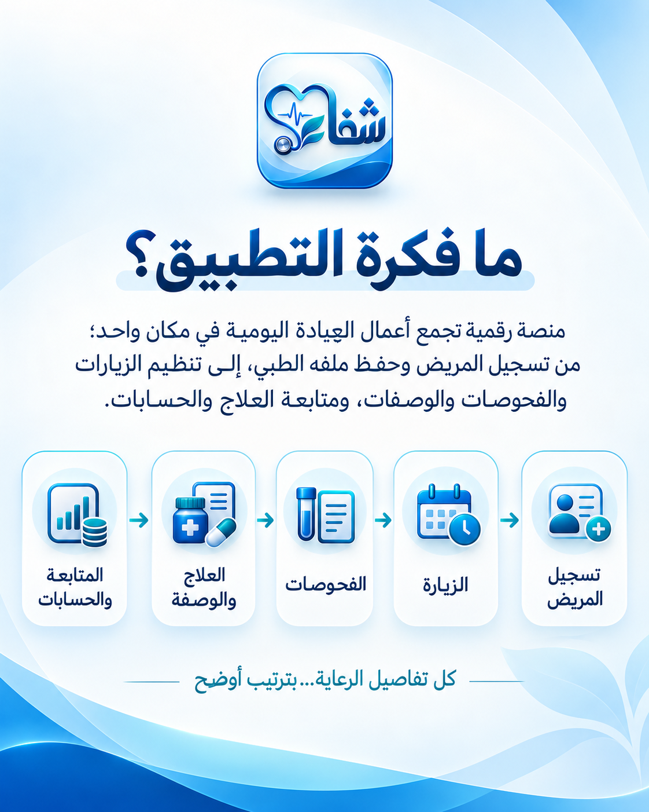 |

| بوابة الطبيب | الزيارات والسجل الطبي |
|---|---|
| 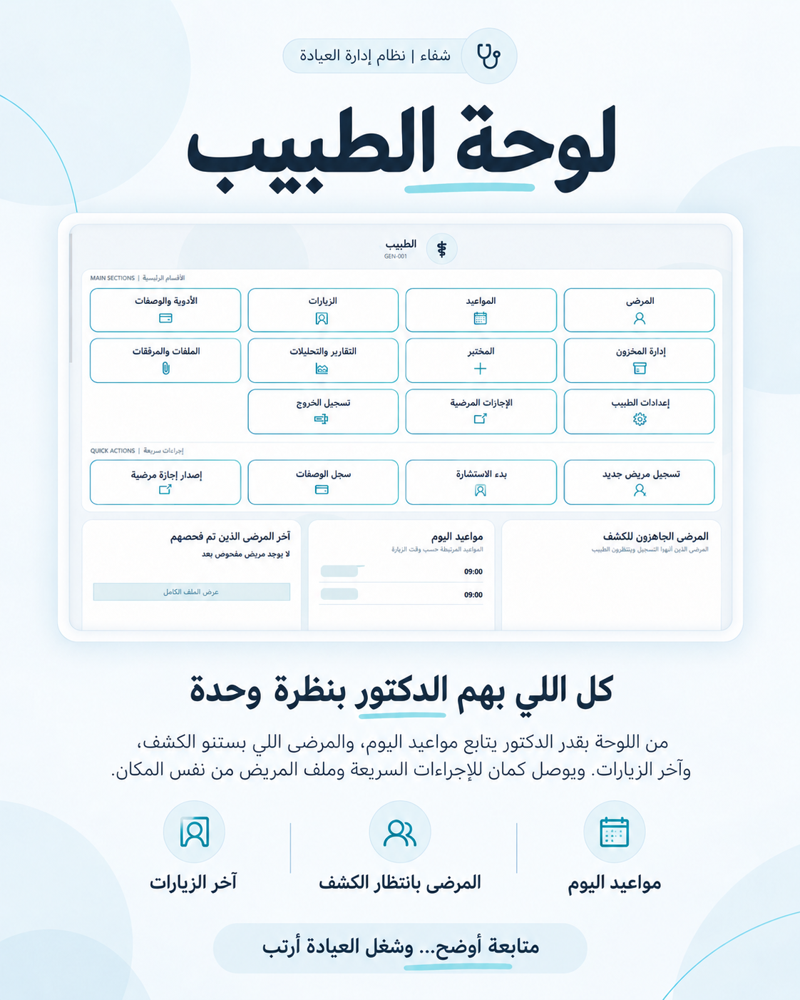 | 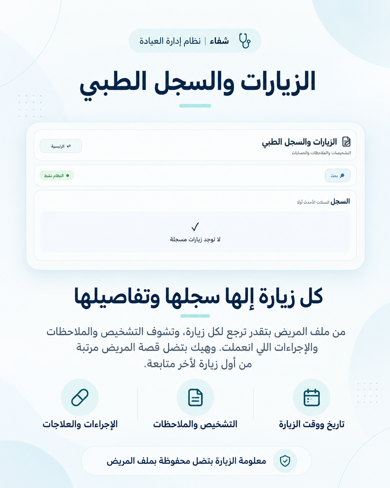 |

| المواعيد | المختبر |
|---|---|
| 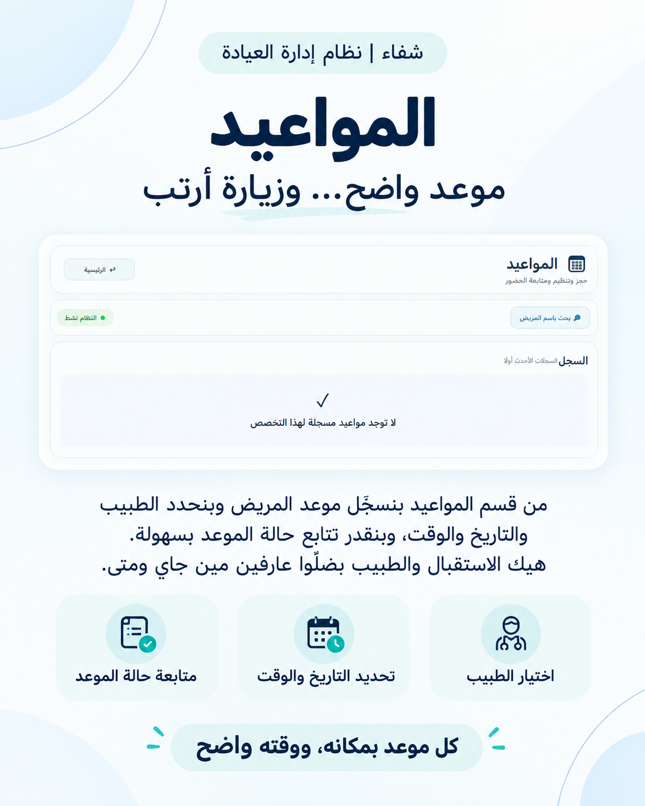 | 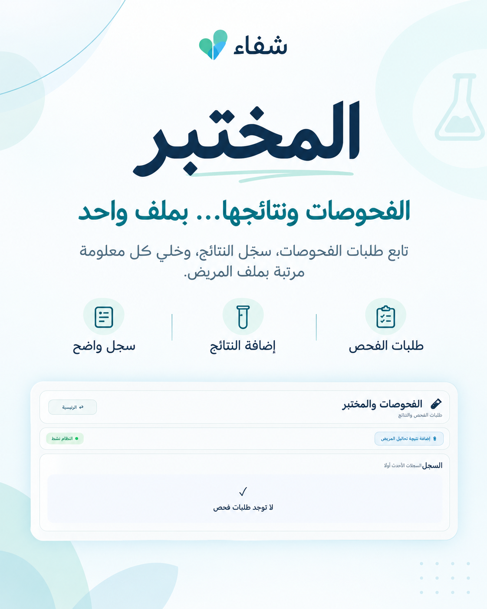 |

| مخزون العيادة | الأدوية الخارجية |
|---|---|
| 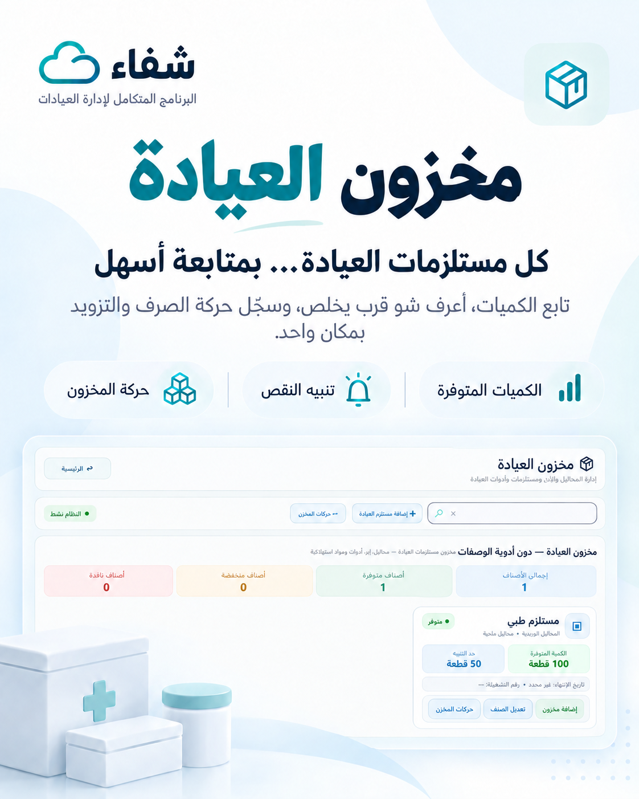 | 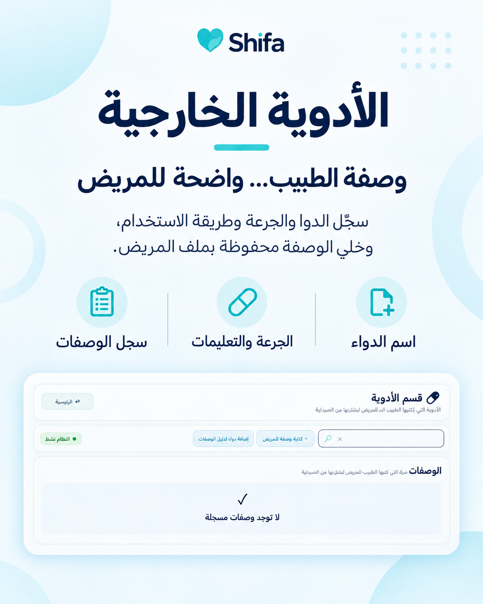 |

| إعدادات الطبيب | بوابة التمريض |
|---|---|
| 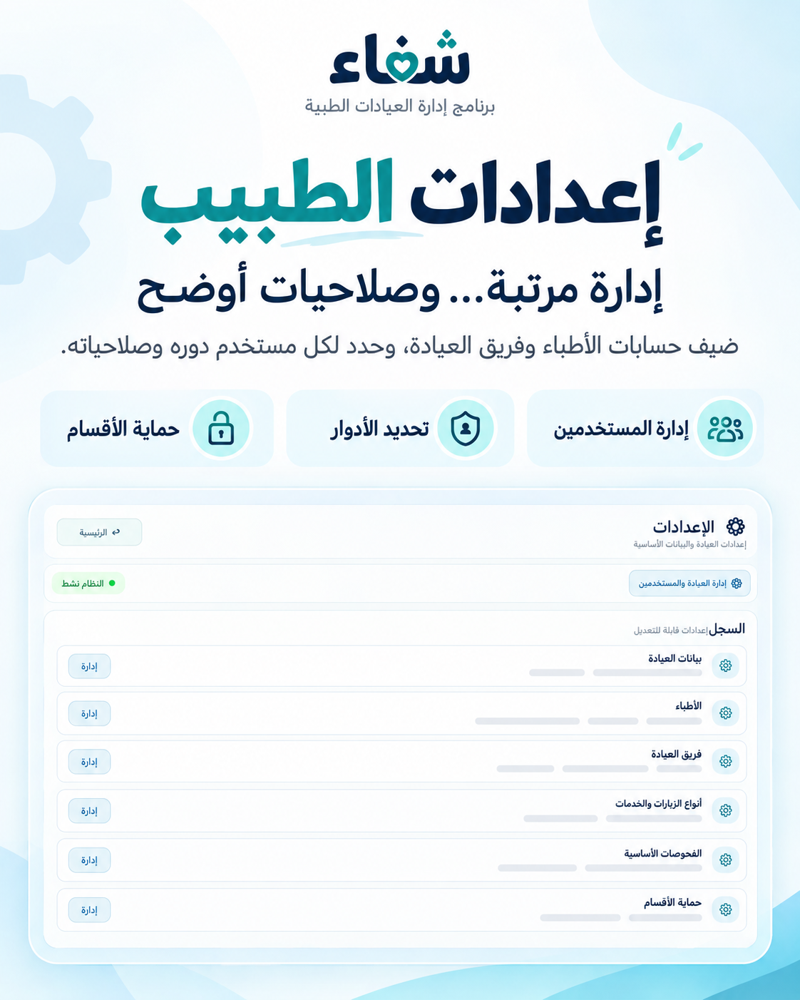 | 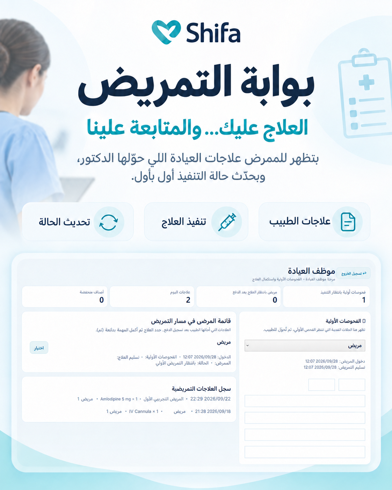 |

| الاستقبال والحساب | التقارير والإحصائيات |
|---|---|
| 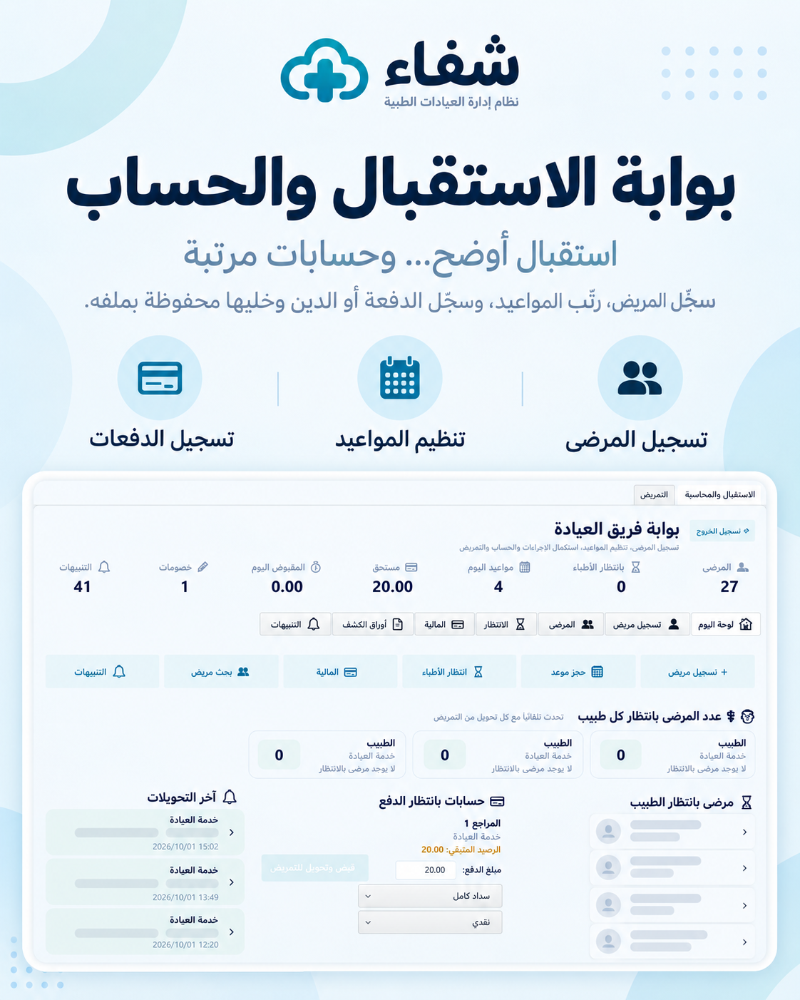 | 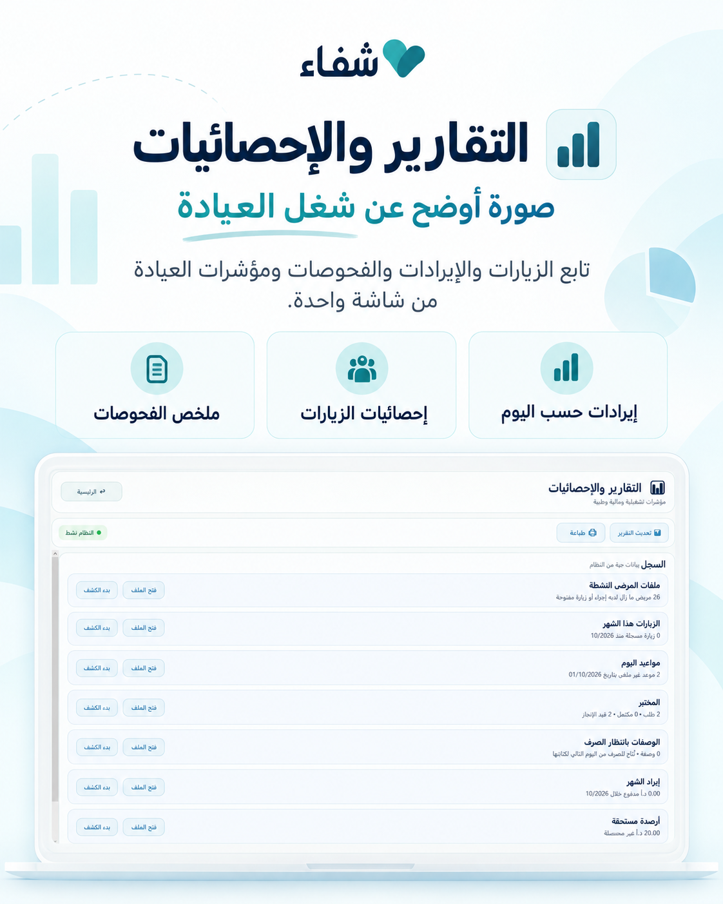 |

| لمن صُمّم النظام؟ | التواصل |
|---|---|
| 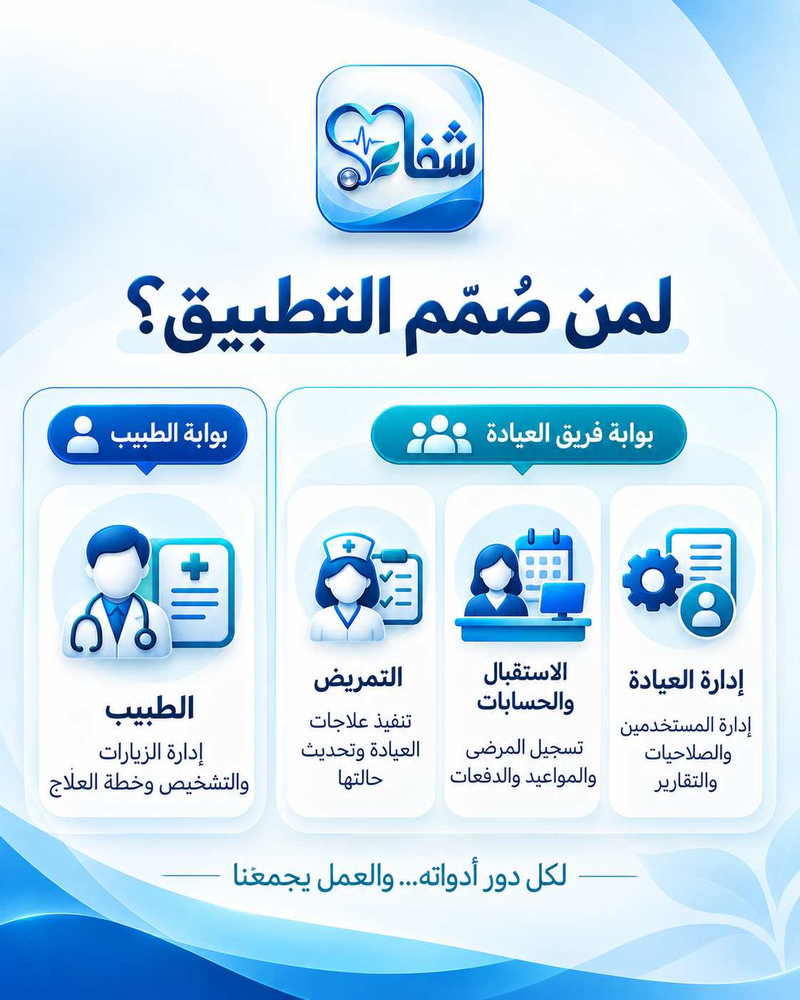 | 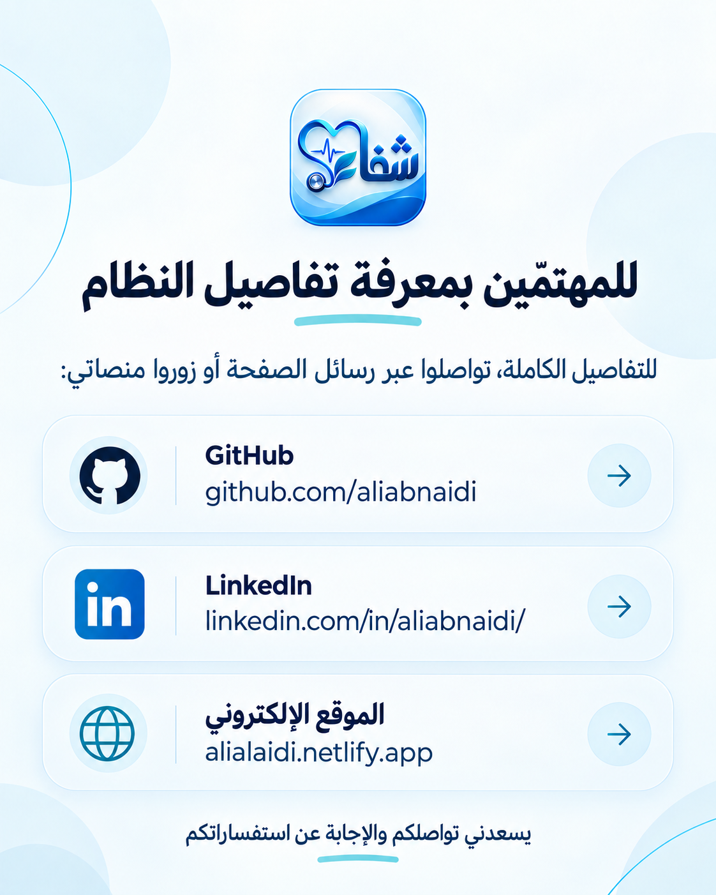 |

## 📬 تواصل واطلب النظام

حابب تعرف تفاصيل أكثر أو تطلب النظام؟ يسعدني تواصلك:

- 🌐 [الموقع الإلكتروني](https://alialaidi.netlify.app/)
- 💼 [LinkedIn](https://www.linkedin.com/in/aliabnaidi/)
- 🧑‍💻 [GitHub](https://github.com/aliabnaidi)

**راسلني عبر لينكدإن أو الموقع للاستفسار عن النظام وطلبه.**

### شفاء — كل تفاصيل العيادة بمكان واحد 💙

---

## English

# 🩺 Shifa | Clinic Management System

Shifa is a clinic workflow concept for organizing patient records, visits, appointments, prescriptions, laboratory requests, in-clinic treatments, inventory, payments, and reports.

🔒 This repository is for project information and showcase images only. The application source code, program files, and patient data are not included. Contact me to inquire about or request the system.

- 🌐 [Website](https://alialaidi.netlify.app/)
- 💼 [LinkedIn](https://www.linkedin.com/in/aliabnaidi/)
- 🧑‍💻 [GitHub](https://github.com/aliabnaidi)

**Shifa — the clinic’s workflow, organized in one place.**
